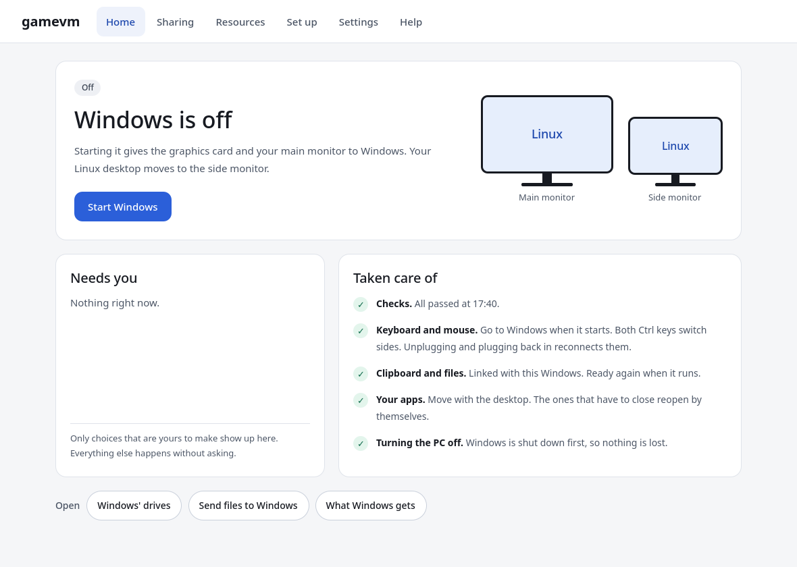
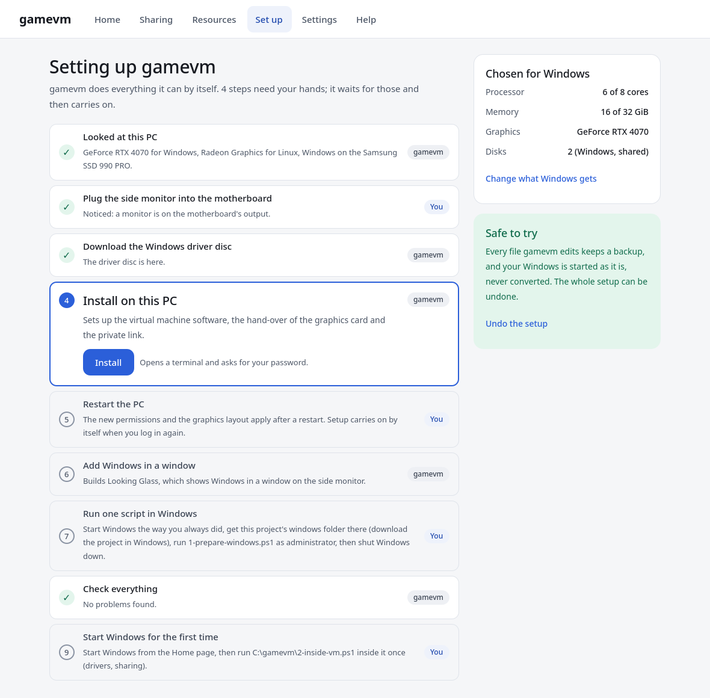
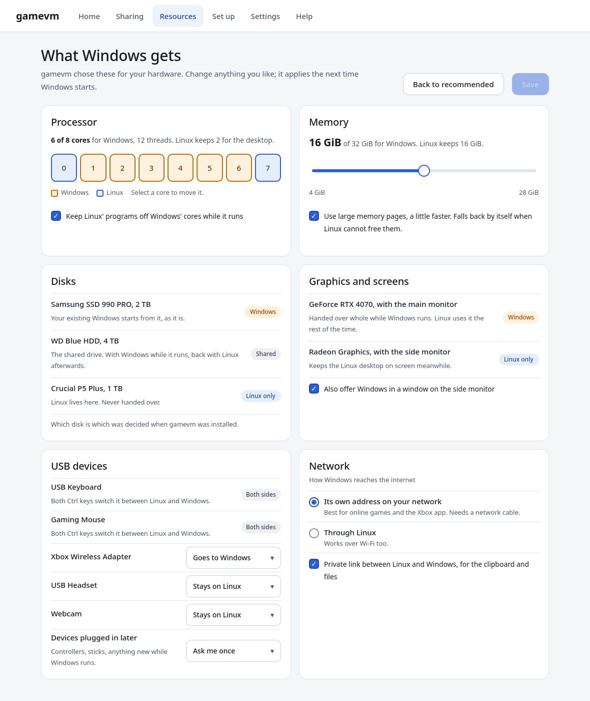
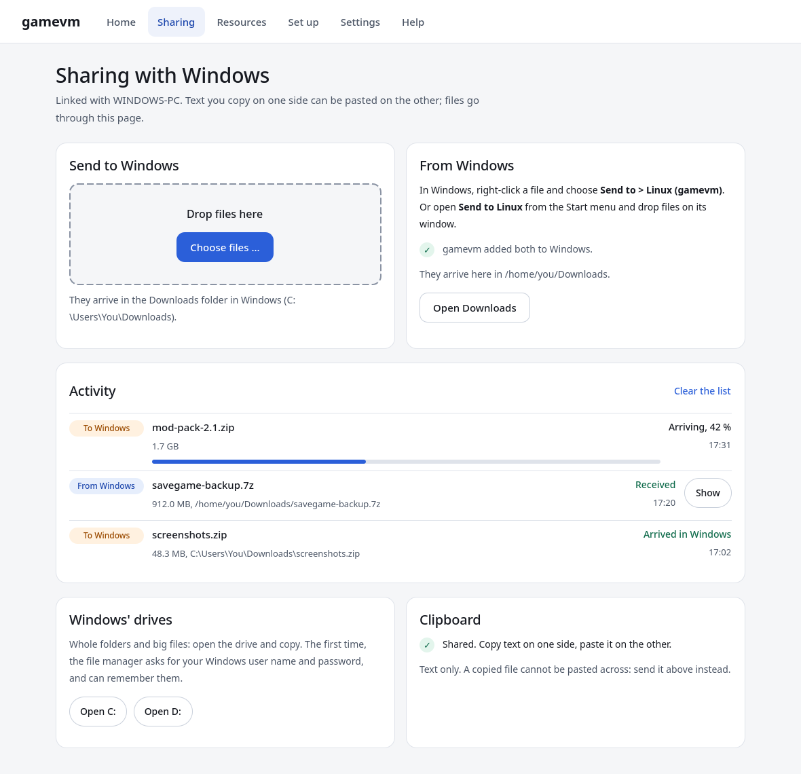

# gamevm

Run the Windows that is already on your PC as a virtual machine on Linux, at close to native
speed, and get everything back the moment it shuts down.

Windows gets the **whole graphics card** and the **whole drive it is installed on**, so games, the
Xbox app and PC Game Pass run on the real graphics driver, in the Windows you already have. Linux
keeps running next to it. When Windows shuts down,
the graphics card, the processor cores and the memory go back to Linux, and you can still boot the
same Windows natively whenever a game demands it.



A window does the work: it starts and stops Windows, walks through the setup, sets what Windows
gets, and moves files between the two. Everything is also a command (`gamevm start`, `gamevm stop`).

## Status

gamevm was built and tested on **one PC**: a Ryzen 7 9800X3D with its built-in Radeon graphics, an
RTX 4080 SUPER, KDE Plasma 6 on Wayland, CachyOS. The installer detects the hardware of the PC it
runs on, but other hardware is untested, an Intel built-in graphics chip in particular. That PC has
Windows on an NVMe drive: starting Windows from a SATA disk is built and checked as far as it can
be without one (the VM's firmware starts from a disk attached that way), but no real Windows has
been started from one yet. Expect rough edges, read what the installer says before you confirm,
and please report what you find.

It changes how your PC hands hardware to a virtual machine. It is careful (see *Safety*), every
change can be undone, and it comes with no warranty.

## What you need

- An **Arch-based Linux** (Arch, CachyOS, EndeavourOS, ...) with systemd; **KDE Plasma 6 on
  Wayland** if Linux should stay on screen while Windows runs.
- An **NVIDIA graphics card**, which goes to Windows while it runs.
- An existing **Windows 11 on a drive of its own** (not shared with Linux): an **NVMe drive**, which
  Windows gets as the hardware itself, or a **SATA disk** (SSD or hard disk), which the VM shows to
  Windows as a SATA disk.
- Virtualisation and IOMMU switched on in the BIOS.
- Optional, and worth it: a **second graphics chip**, usually the one built into the CPU, with a
  monitor cabled to the motherboard.

See what gamevm makes of your PC before installing anything:

```bash
git clone <this repository> gamevm && cd gamevm
python3 gamevm/gamevm.py discover
```

Details, BIOS settings and cabling: [docs/01](docs/01-requirements-and-cabling.md).

## Two modes

| | **iGPU mode** | **single-GPU mode** |
|---|---|---|
| Needs | a second graphics chip (the CPU's) and a monitor on the motherboard | nothing |
| Linux desktop while Windows runs | **stays on screen** on that monitor. KDE's own apps stay open; other apps close for the switch and are reopened | closes; Linux keeps running without a screen and the desktop returns when Windows stops |
| Where Windows shows | on the monitor of the graphics card, at full refresh rate with G-SYNC/VRR and HDR; optionally also in a window on the Linux desktop (Looking Glass) | on every monitor |
| The graphics card while Windows is off | Linux uses it normally, also for Linux games | Linux uses it normally |

gamevm picks iGPU mode whenever a second graphics chip is present.

## Install

```bash
sudo ./setup/install-host.sh --dry-run     # shows every change, makes none
sudo ./setup/install-host.sh               # installs; safe to run again
```

Then open **gamevm** from the application launcher (or `gamevm ui`). Its *Set up* page lists every
step, does its own by itself and waits for yours:



| Step | Who |
|---|---|
| Look at the PC: graphics card, Windows disk, keyboard, mouse, cores | gamevm |
| Plug the side monitor into the motherboard (iGPU mode) | you |
| Download the Windows driver disc (about 880 MB) | gamevm |
| Install on this PC (asks for your password) | gamevm |
| Restart the PC | you, one button |
| Add Looking Glass, to see Windows in a window (iGPU mode) | gamevm |
| Boot Windows natively once and run `windows\1-prepare-windows.ps1` there | you ([docs/02](docs/02-windows.md)) |
| Check everything | gamevm |
| Start Windows in the VM and run `C:\gamevm\2-inside-vm.ps1` in it once | you |

The installer takes a snapshot first where snapper is set up, never touches the boot loader or the
kernel command line, and keeps a `.gamevm.orig` backup of every file it edits.
`sudo ./setup/uninstall-host.sh` reverses it.

## Daily use

| | |
|---|---|
| **Home** | Start and shut down Windows. *Needs you* holds only what is yours to decide; *Taken care of* lists what happened without asking. |
| **Sharing** | Drop files to send them to Windows and watch them arrive; files from Windows show up here. Shared clipboard for text. Windows' drives in the file manager. |
| **Resources** | What Windows gets: processor cores, memory, USB devices, network. |
| **Settings**, **Help** | How the switch behaves; the checks in full, the guides, repair after a crash. |




Press **both Ctrl keys** to move the keyboard and mouse between Windows and Linux.

The same as commands:

```bash
gamevm ui         # the window
gamevm start      # Windows on the graphics card; the Linux desktop moves to the side monitor
gamevm stop       # clean shutdown; everything goes back to Linux
gamevm lg         # Windows in a window (Looking Glass)
gamevm status     # who has what right now
gamevm files      # Windows' drives in the file manager, also while Windows runs
gamevm share      # shared clipboard and file sending: status, --pair
gamevm doctor     # every check, with what to do about each finding
gamevm discover   # the hardware gamevm found on this PC
```

More: [daily use](docs/03-daily-use.md), [troubleshooting](docs/04-troubleshooting.md),
[performance](docs/06-performance.md).

## What it does not do

- **Games whose anti-cheat refuses virtual machines** (Valorant, recent Call of Duty, Battlefield 6
  and others) do not run in the VM, and gamevm does not try to hide it. Boot the same Windows
  natively for those ([docs/05](docs/05-games-and-anti-cheat.md)).
- AMD or Intel cards as the card for Windows, distributions without `pacman`, and iGPU mode on
  desktops other than KDE Plasma are not supported yet.
- Windows on the same drive as Linux, on a USB disk, or on a SATA disk with 4096-byte sectors
  ("4Kn", rare; `gamevm discover` says so).

## Safety

- **The Windows disk is protected.** gamevm records which drive it is (model IDs and serial
  number) and refuses to start if another drive sits in its place, if it is the disk Linux runs
  from, if Linux still has part of it mounted, or if Windows left it hibernated (Fast Startup).
- **The graphics card is never torn away.** The NVIDIA driver is unloaded the regular way, which
  refuses safely if anything still uses the card.
- **Every change to the host is written down** (`/run/gamevm/state.json`) and undone in reverse
  order, on shutdown or as soon as a step fails. `sudo gamevm recover` handles crashes.
- **The desktop session survives the switch.** KWin is restarted through its own interface, never
  killed. If the graphics card does not come back healthy after Windows, the desktop stays on the
  side monitor instead of a dead screen.
- **Windows is shut down before the PC is.** Shutting down or restarting Linux waits for Windows
  first; sleep is blocked while Windows runs.
- **Problems are found before the desktop moves**: a kernel updated without a restart, a stopped
  network, a missing keyboard or disk.
- **Sharing stays inside the PC.** Clipboard, file sending and the drive shares use a private link
  between Linux and Windows that no other machine can reach.

## Inside the project

```
config/gamevm.toml          configuration template (installed to /etc/gamevm/gamevm.toml)
gamevm/gamevm.py            the command and the libvirt hook: checks, hand-over, isolation, VM definition
gamevm/gamevm_discover.py   finds the hardware of the PC (gamevm discover)
gamevm/gamevm_doctor.py     the checks (gamevm doctor)
gamevm/gamevm_ui.py, ui/    the window: a small local service and its QML pages
setup/                      install-host.sh, uninstall-host.sh, their helper
host/                       device rule, units, launcher entries
looking-glass/              installer for the Looking Glass client and its kernel module
windows/                    the scripts that run in Windows
docs/                       the guides
tests/                      tests that run without a VM
```

Try things without root and without changing anything:

```bash
./tests/run.sh                                                   # the test suites
python3 -I tests/test_sata_boot.py firmware                      # also: the VM's firmware starts a made-up SATA disk
python3 gamevm/gamevm.py discover                                # what the installer would use
python3 gamevm/gamevm.py --dry-run selftest --mode igpu          # every host change and its undo (after installing)
GAMEVM_UI_DEMO=running python3 gamevm/gamevm.py ui               # the window with a made-up PC
```

## Contributing and licence

Reports from other hardware are the most useful contribution right now; see
[CONTRIBUTING.md](CONTRIBUTING.md).

gamevm is free software under the [GNU General Public License v3.0](LICENSE). Copyright (C) 2026
Karim Dagher. It comes without any warranty.

Looking Glass, KDE Connect, the virtio-win drivers and QEMU/libvirt are separate projects with
their own licences; gamevm downloads or uses them, it does not include them.
